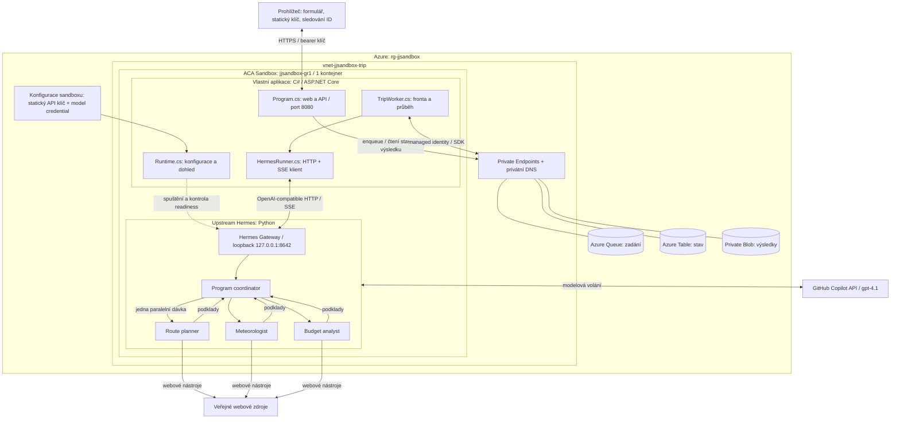

# Hermes: multi-agentní plánování výletu v C#

ASP.NET Core / .NET 10 aplikace přijímá textové zadání výletu přes web.
Nevyžaduje souborový upload, Node.js ani npm. Web je součástí C# projektu
v `src/Trip/wwwroot`; původní OpenClaw demo bylo odstraněno.

## Co běží v C# a co dělá Hermes

| Součást | Odpovědnost |
|---|---|
| `Program.cs` | HTTP API, statický web, bearer autentizace, validace JSON a bezpečnostní hlavičky |
| `Runtime.cs` | Načtení konfigurace, interní náhodný Gateway klíč, spuštění a dohled nad Hermes |
| `TripWorker.cs` | Zpracování fronty, obnova lease, průběh a terminální stav |
| `AzureTripStore.cs` | Azure Queue, Table a neveřejné Blob výsledky přes managed identity |
| `HermesRunner.cs` | Adaptace travel-demo promptu, SSE stream, timeouty a detekce chyb |
| Původní Hermes engine | Modelová smyčka, webové nástroje, paralelní specialisté a syntéza |

C# předá celé zadání jednomu Hermes koordinátorovi. Ten jednou paralelně
deleguje plánování trasy, počasí a rozpočtu třem specialistům a sestaví
český itinerář. Pravidla vycházejí z `hermes/HERMES.md` a
`hermes/prompts/travel-demo.txt`; souborové vstupy a výstupy se pro web
nahrazují HTTP textem a Blob výsledkem. Agent nic nerezervuje.

Samotný upstream Hermes je napsaný v Pythonu a zůstává v oficiálním image.
Naše aplikace, supervisor i kontrola image jsou C#; vlastní Python pomocné
skripty nejsou potřeba. Nejde o přepis Hermes enginu do jiného jazyka.

Model `gpt-4.1` se volá přes GitHub Copilot, nikoli Azure OpenAI.
Konfigurace `hermes/sandbox-config.yaml` omezuje kontext na 64 000 tokenů,
delegaci na hloubku jedna a tři specialisty. Povoleny jsou web a delegace,
nikoli shell, filesystem, cron či persistentní paměť jako nástroje agenta.
Hermes sám ukládá interní historii relací na disk sandboxu.

## Architektura



**Hermes Gateway není C# kód.** Je součástí upstream Python runtime.
`HermesRunner.cs` je jeho C# HTTP klient a `Runtime.cs` jeho C# spouštěč
a supervisor. Z prohlížeče se Gateway nevolá a jeho port není veřejný.

## Použití webu a API

Na HTTPS adrese nasazeného sandboxu vlož přístupový klíč a zadání.
Výsledek se objeví pod formulářem. Prohlížeč si pamatuje jen ID úlohy
a přidá jej do URL jako `?trip=ID`. Po obnovení stránky znovu vlož klíč
a klikni **Obnovit sledování**; není nutné znovu odesílat zadání.
Klíč ani text požadavku se do localStorage neukládají.

### Ukázkový prompt

Do pole zadání můžeš vložit tento prompt použitý při ověřování nasazení:

```text
Naplánuj jednodenní výlet 7. listopadu 2026 z Prahy do Kutné Hory a zpět
vlakem pro dva dospělé, odjezd po 8:00, návrat do 20:00, rozpočet 3000 Kč.
Historické památky, krátká procházka a oběd. Ověř počasí; neověřené údaje
označ. Nic nerezervuj.
```

Pro vlastní výlet změň datum, místo, počet osob a rozpočet. Výsledkem je
český itinerář s dopravou, počasím, odhadem nákladů a popisem spolupráce
agentů; nejde o rezervaci ani záruku aktuálnosti uvedených údajů.

### API

- `POST /api/trips`: pouze JSON `{"requestText":"..."}`, vrací ID a `statusUrl`.
- `GET /api/trips/{id}`: stav, průběh a hotový výsledek.
- `/healthz` a statický formulář jsou veřejné; všechny `/api` cesty vyžadují
  `Authorization: Bearer <TRIP_API_KEY>`.
- Limity: 20 000 znaků, 24 KiB JSON, celkový běh 25 minut, neaktivní SSE 2 minuty.

Požadavky se ukládají do Azure Queue se sedmidenní TTL; výsledky do neveřejného
Blob kontejneru s 30denní retencí. Table obsahuje stav, nikoli zadání či plán.
Tato retence se nevztahuje na interní Hermes historii.
Dokončení běhu negarantuje správnost spojů, cen ani otevíracích dob.

## Sestavení a testy

Požadavky: .NET SDK 10, Docker, Azure CLI a preview ACA Sandbox CLI.

```powershell
dotnet test Trip.slnx
.\infra\build-trip-image.ps1
```

Build provede hostitelský `dotnet publish` do ignorované `.build/publish`
a Docker zkopíruje přenosné DLL do oficiálního Hermes image s ASP.NET runtime.
NuGet tedy používá TLS konfiguraci hostitele; ověřování certifikátů se nevypíná.
Kontrola `dotnet Trip.dll --check-config` ověřuje modelový limit
a parametry delegace bez přístupu k modelu a bez secrets.

Lokálně nastav `TRIP_API_KEY`, `HERMES_API_KEY`,
`AZURE_STORAGE_ACCOUNT_NAME` a spusť `dotnet run --project src\Trip`.
Externí Hermes Gateway musí být dostupná na `127.0.0.1:8642`.

## Azure nasazení

Cíl: subscription `JJAzDev Internal1`
(`80214fc0-7aff-43b6-bbff-cf81a36cbb10`), `swedencentral`,
resource group `rg-jjsandbox`, existující Sandbox Group `jjsandbox-gr1`.
Jde o ACA Sandbox, nikoli běžnou Azure Container App.

**Ověřené nasazení 4. 11. 2026:**
[webový formulář](https://c2a33bf1-fb60-4241-b754-9d74b5ac60c1--8080.swedencentral.adcproxy.io).
[Hotový testovací výsledek](https://c2a33bf1-fb60-4241-b754-9d74b5ac60c1--8080.swedencentral.adcproxy.io/?trip=27a5710f-6213-4eed-832f-f7fb016de20d)
obnovíš zadáním stejného klíče a kliknutím na **Obnovit sledování**.
Úloha skončila jako `completed` přibližně za minutu a uložila 4 736 znaků.
Nová instance používá image `hermes-trip`, `Trip.dll` a `TRIP_API_KEY`.
Původní uložené výsledky jsou dostupné i přes novou adresu se stejným klíčem.
Běží pouze jedna Trip instance. Nahrazená instance, šest starých image
a nepoužívané síťové připojení byly odstraněny.

Dedikovaná VNet `vnet-jjsandbox-trip` je ve stejném resource groupu.
Má adresní prostor `10.42.0.0/16`, delegovaný ACA subnet `10.42.0.0/23`
a Private Endpoint subnet `10.42.2.0/27`. Blob, Queue a Table mají vlastní
private endpoint a privátní DNS. Storage `tripfiv6psfk5vqje` nadále zakazuje
veřejnou síť, shared keys a anonymní Blob přístup.
Šablona nevytváří peering ani nemění původní sdílený `jjvnethub`.

```powershell
az deployment group create --resource-group rg-jjsandbox `
  --template-file infra\trip-private-network.bicep `
  --parameters infra\trip-private-network.bicepparam

aca sandboxgroup network create --group jjsandbox-gr1 --name jjsandbox-trip `
  --vnet-subnet-id "/subscriptions/80214fc0-7aff-43b6-bbff-cf81a36cbb10/resourceGroups/rg-jjsandbox/providers/Microsoft.Network/virtualNetworks/vnet-jjsandbox-trip/subnets/aca-sandboxes"

.\infra\build-trip-image.ps1
aca sandboxgroup disk create --source . --name hermes-trip --group jjsandbox-gr1
.\infra\deploy-trip-sandbox.ps1 -DiskId "<vrácené disk ID>"
```

Deployment helper čte chráněnou lokální konfiguraci
`config-secret\runtime.json` v kořeni tohoto pracovního stromu s položkami
`TRIP_API_KEY` a `COPILOT_GITHUB_TOKEN` (oba alespoň 32 znaků).
Složka `config-secret` je ignorovaná Gitem i Docker build kontextem a má
omezená přístupová práva. Není součástí commitu ani nasazeného image.
Obsah nikam nekopíruj do ukázek, logů nebo sdílených konfigurací.
Klíč pro web je statický a při vytvoření se uloží do konfigurace sandboxu.
Copilot credential je předán jako `TRIP_COPILOT_TOKEN`; C# ho předá jen
procesu Hermes jako `COPILOT_GITHUB_TOKEN`. Interní Gateway klíč se generuje
náhodně při startu a uživatel ho nemusí spravovat.

Helper používá autentizované datové API: obsah konfigurace zůstává v paměti
a těle HTTPS požadavku, nikoli v argv, zdrojových souborech nebo image.
Preview API používá `PUT` kolekce a token scope `https://dynamicsessions.io/.default`.
Secrets mohou číst správci konfigurace sandboxu; nejde o veřejnou konfiguraci.
Nikdy je nevypisuj přes debug, nevkládej do URL ani veřejného JavaScriptu
a neprováděj snapshot nebo commit instance obsahující credentials.

C# proces spustí loopback Hermes Gateway (`127.0.0.1:8642`), ověří jeho
readiness a privátní Storage a teprve poté obsluhuje port 8080.
Po ověření vystav pouze tento port:

```powershell
aca sandbox port add --id "<sandbox ID>" --group jjsandbox-gr1 --port 8080 --anonymous
.\infra\test-trip.ps1 -BaseUrl "https://<vrácený hostname>"
```

Smoke test ověří formulář, health, odmítnutí požadavku bez klíče a skutečnou
úlohu až do uloženého `completed`. Volba `-ExistingJobId` ověří uložený
výsledek bez opakovaného odeslání zadání. Konkrétní průběh deploymentu
a poslední důkazy jsou v `.azure/deployment-plan.md`.

Přejmenování Azure prostředků bylo provedeno vytvořením náhrad, nikoli změnou
názvu na místě. Nové endpointy se jmenují `trip-storage-blob`,
`trip-storage-queue` a `trip-storage-table`. Storage účet a data zůstaly zachované.
Při podobné výměně vždy zkontroluj ARM what-if a po odstranění starých endpointů
ověř privátní DNS: odstranění staré skupiny může smazat sdílený A záznam.
Pouhé opětovné nastavení existující DNS zone group zde záznamy neobnovilo;
chybějící A záznamy byly obnoveny podle skutečných IP nových endpointů.
Následně byl ověřen i skutečný požadavek aplikace.

Klíč lze zkopírovat do schránky bez výpisu:

```powershell
(Get-Content ".\config-secret\runtime.json" -Raw |
  ConvertFrom-Json).TRIP_API_KEY | Set-Clipboard
```

## Původní lokální Hermes demo

`hermes/run-demo-copilot.ps1` zachovává původní interaktivní scénář se
vstupem `data/travel-request.txt` a výstupem `hermes/artifacts/weekend-plan.md`.
Webové nasazení tento vstupní soubor nepoužívá.
